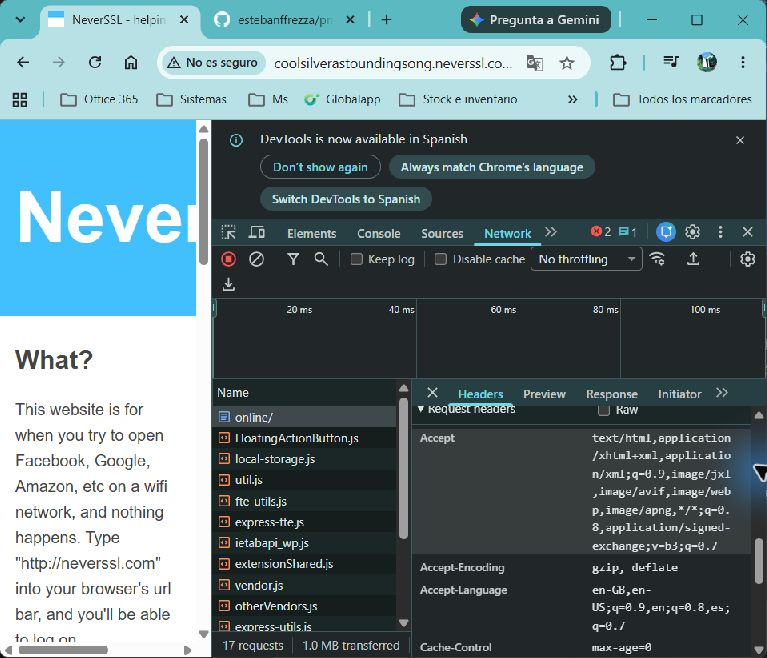
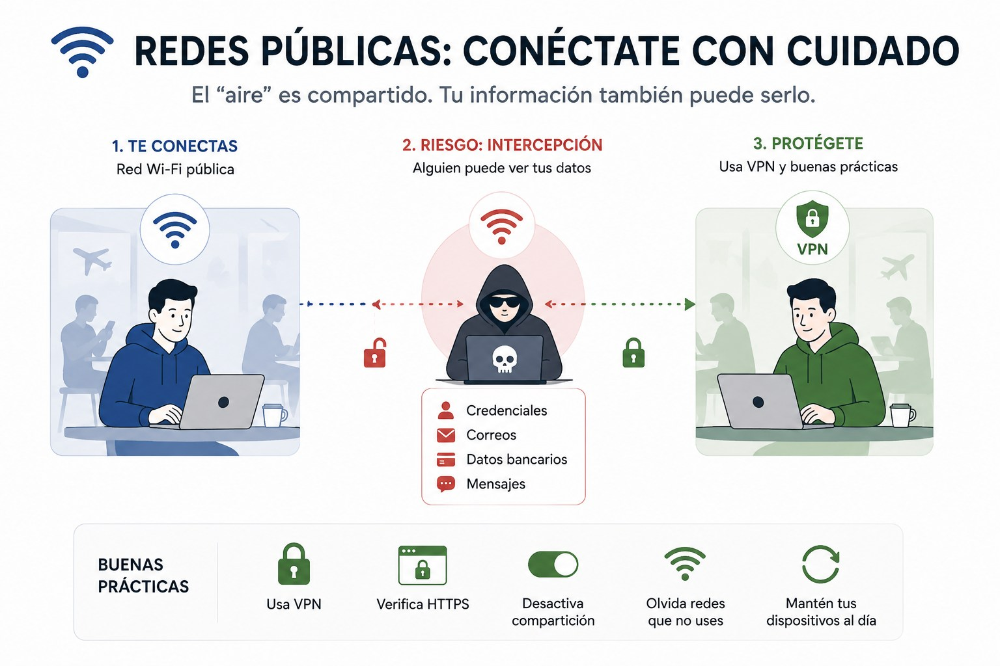

# Informe de auditoría de red Wi-Fi insegura

## Introducción

Este informe analiza qué puede revelar una conexión HTTP y qué riesgos aparecen al navegar desde una red Wi-Fi pública. También resume cómo una VPN reduce la exposición frente a otros usuarios de la red y qué hábitos conviene mantener.

## Sitio analizado

- URL solicitada: [http://neverssl.com](http://neverssl.com)
- Host de entrada: `neverssl.com`
- Esquema solicitado: HTTP, sin TLS en la URL inicial.

## Evidencia observada

La página cargó en Chrome después de abrir `http://neverssl.com`. En **DevTools > Network**, la solicitud del documento seleccionada fue `GET http://coolsilverastoundingsong.neverssl.com/online/` y devolvió `200 OK`. El host final es un subdominio de `neverssl.com`; el header `Referer` conserva la URL de entrada. La conexión usó HTTP en el puerto 80.

La captura muestra los headers de la solicitud seleccionada en Chrome DevTools. La infografía de la consigna se incluye como material visual complementario.

| Dato | Resultado | Alcance |
| --- | --- | --- |
| URL de entrada | `http://neverssl.com` | URL solicitada en el navegador |
| URL de la solicitud seleccionada | `http://coolsilverastoundingsong.neverssl.com/online/` | Request URL de DevTools |
| Método | `GET` | Request Method |
| Host | `coolsilverastoundingsong.neverssl.com` | Header `Host` enviado por Chrome |
| Protocolo y puerto | HTTP, `:80` | Esquema de la URL y puerto de conexión observado |
| Estado | `200 OK` | Status Code de DevTools |
| `Referer` | `http://neverssl.com/` | Header de la solicitud seleccionada |

Entre los headers observados están `Accept`, `Accept-Encoding`, `Accept-Language`, `Cache-Control`, `Connection`, `Host`, `Referer` y `Upgrade-Insecure-Requests`. Chrome también envió `User-Agent`; no incluyo su valor completo porque describe detalles del navegador y del entorno local.

La respuesta mostrada incluyó `Content-Type: text/html; charset=UTF-8`, `Content-Encoding: gzip` y `Server: Apache/2.4.68 ()`. Una consulta HTTP auxiliar desde otro cliente de este entorno devolvió `403 Forbidden`; no se mezcló esa respuesta con la captura de Chrome, que muestra `200 OK`.

## Análisis técnico

### 1. ¿Qué protocolo utiliza el sitio?

La URL de entrada y la solicitud del documento usan **HTTP** (`http://`). HTTP no cifra por sí mismo la solicitud ni la respuesta. DevTools muestra la solicitud sobre el puerto 80 con estado `200 OK`.

### 2. ¿Qué información puede observarse durante una solicitud HTTP?

En una captura HTTP sin TLS, un observador con acceso al tráfico puede leer los datos de la solicitud que viajan en claro, entre ellos:

- el host solicitado, por ejemplo `neverssl.com`;
- la ruta y los parámetros de la URL;
- el método, como `GET`;
- headers enviados, que pueden incluir `User-Agent`, `Accept` y, según el contexto, cookies;
- el contenido de la respuesta que no esté cifrado por otra capa.

La lista real depende del navegador, la petición y el estado de la sesión. En esta comprobación, DevTools permitió observar el host, el método, la URL y los headers de la solicitud seleccionada.

### 3. Riesgos de usar HTTP en una Wi-Fi pública

Otro participante de la red o un punto de acceso comprometido podría observar o alterar tráfico HTTP. Según el sitio y la petición, esto puede exponer páginas visitadas, parámetros, contenido enviado y cookies de sesión que no tengan protección adecuada. Un atacante también podría redirigir solicitudes o modificar respuestas. Una contraseña compartida para conectarse a la Wi-Fi no convierte HTTP en una conexión cifrada ni garantiza que los dispositivos conectados sean confiables.

HTTPS protege el contenido de la conexión entre el navegador y el sitio mediante TLS. Aun así, metadatos de conexión pueden seguir siendo visibles en ciertas condiciones, y el usuario debe comprobar el dominio y no ignorar advertencias de certificado.

### 4. ¿Cómo ayuda una VPN?

Una VPN establece un **túnel cifrado** entre el dispositivo y el servidor VPN. El **encapsulamiento** transporta los paquetes dentro de ese túnel y el **cifrado** dificulta que otros usuarios de la Wi-Fi lean o modifiquen su contenido durante el trayecto local.

La VPN reduce la exposición del tráfico frente a la red pública, pero no sustituye HTTPS: el tramo desde el servidor VPN hasta un sitio HTTP todavía puede ir sin cifrado de extremo a extremo. El proveedor de VPN también puede observar parte de los metadatos de salida. Conviene usar un servicio confiable y mantener HTTPS activado.

## 3 Reglas de Oro para redes Wi-Fi públicas

1. **Verificá la red antes de conectarte.** Confirmá el nombre con el personal del establecimiento; evitá redes abiertas o gemelas con nombres parecidos.
2. **Usá HTTPS y una VPN confiable.** No ingreses credenciales ni datos sensibles en páginas HTTP, y no ignores alertas de certificado.
3. **Reducí la exposición del dispositivo.** Desactivá la conexión automática y el uso compartido de archivos; al terminar, desconectate y olvidá la red.

## Conclusión

HTTP deja el contenido de la solicitud expuesto a quien pueda observar el tráfico. HTTPS cifra la conexión con el sitio y una VPN añade un túnel cifrado a través de la Wi-Fi pública. Son protecciones complementarias; ninguna vuelve confiable por sí sola a una red desconocida.

